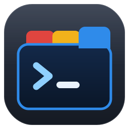

# WT SSH Manager

A small Windows GUI for managing SSH sessions as color-coded Windows Terminal profiles, so you never confuse one shell for another.



## Features

- **One profile per session:** host, username, port, and a fixed tab title the remote shell can't overwrite.
- **Color coding:** tab color, background, and text color per session, with eight presets and a live preview.
- **Run at login:** commands that run right after connecting, e.g. `cd ~/projects/api` then `claude --continue`. Optionally drops you into a normal shell afterwards.
- **No stored passwords:** "Set up key login" uses your password once to install an SSH key on the server. Every login after that is automatic.
- **Launch several at once:** Ctrl- or Shift-click sessions, then open them as tabs, split panes in a grid, or separate windows.
- **Double-click** a session (or press Enter) to open it.
- **Safe edits:** backs up `settings.json` before every save (keeps the last 10) and only touches profiles it created.

## Requirements

- Windows 10 or 11 with [Windows Terminal](https://aka.ms/terminal)
- OpenSSH Client (built into Windows; add it from Optional Features if missing)
- Servers running bash (any standard Linux host)

## Install

```powershell
git clone https://github.com/rhmoniz/Powershell-SSH-Manager.git
cd Powershell-SSH-Manager
Unblock-File .\*.ps1
.\Install-Shortcut.ps1
```

This adds **WT SSH Manager** to the Start menu with a **Ctrl+Alt+S** hotkey. To run it without a shortcut:

```powershell
powershell -ExecutionPolicy Bypass -File .\WT-SSH-Manager.ps1
```

## Usage

1. Click **New**, enter a name, host, and username.
2. Pick a color preset or set your own colors.
3. Click **Set up key login** once per server and type the password in the console window that opens.
4. Click **Save to Windows Terminal**, then double-click the session to open it.

Tick **Close after opening** to have the manager close once your sessions launch.

## How it works

- Sessions are stored in `%APPDATA%\WT-SSH-Manager\sessions.json`. This file contains no passwords or keys.
- Each session becomes a Windows Terminal profile in `settings.json`. Windows Terminal picks up changes immediately.
- Login uses your SSH key at `%USERPROFILE%\.ssh\id_ed25519`, created on first use if it doesn't exist. You can give it a passphrase for extra protection.
- Run-at-login commands are base64-encoded into the profile's command line, so quotes and special characters pass through intact.

## Notes

- Saving rewrites `settings.json` without any comments it contained. The backup next to it keeps the original.
